# 민들레 4D 체험관 · Mindulle Digital Experience

전통 건축을 소재로 한 4D 디지털 체험 공간입니다. 브라우저에서 바로 열리고 Three.js 로 실시간 렌더링됩니다. 등장 캐릭터는 프로젝트에 포함된 glTF 모델을 17개 뼈대로 움직여 손 모으기·예 갖추기·구슬 세기·나무북 동작을 만들어 냅니다. 소리는 환경음·배경음·효과음 세 갈래로 나뉘어 각각 볼륨을 조절할 수 있습니다.

이 저장소는 스크린샷이나 디자인 시안이 아니라 바로 실행·수정·배포할 수 있는 React + Vite 프로젝트입니다. `npm install` 후 실행하면 되고, `npm run build` 로 정적 호스팅용 `dist/` 를 만듭니다.

> 본 서비스는 개인사업자 민들레 안심케어(사업자등록번호 118-08-71419)가 운영하는 상업용 디지털 콘텐츠입니다. 종교법인의 공식 채널이 아니며, 결제는 디지털 콘텐츠 이용권 구매입니다.

## 화면

| | |
|---|---|
| 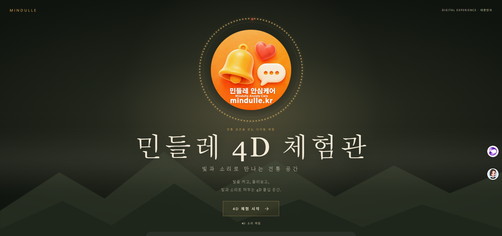 | 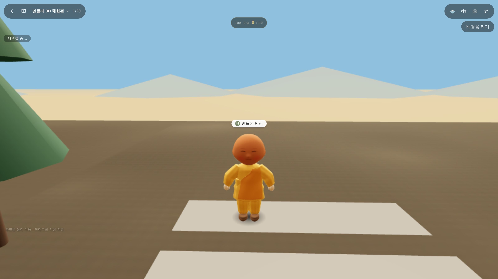 |
| 표지 — 제목과 사업자 정보 | 입구 화면 — 108 구슬 고리와 `4D 체험 시작` |
| 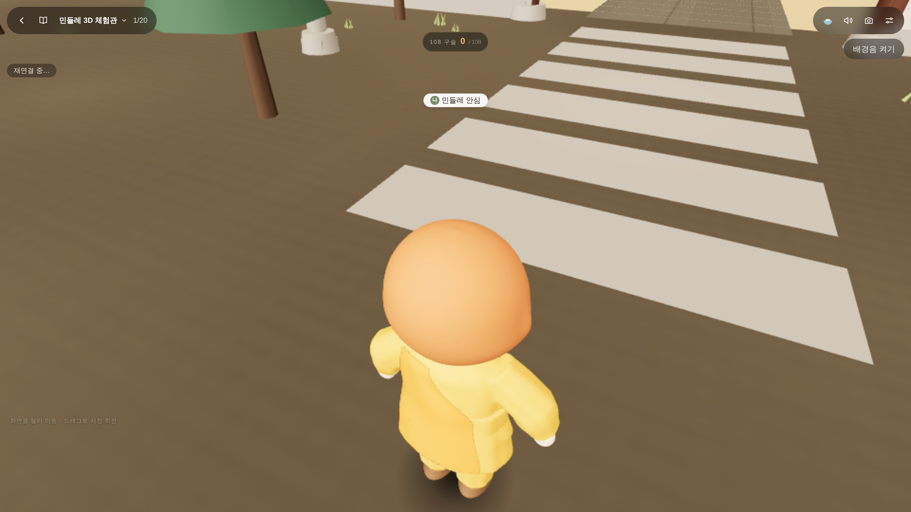 | 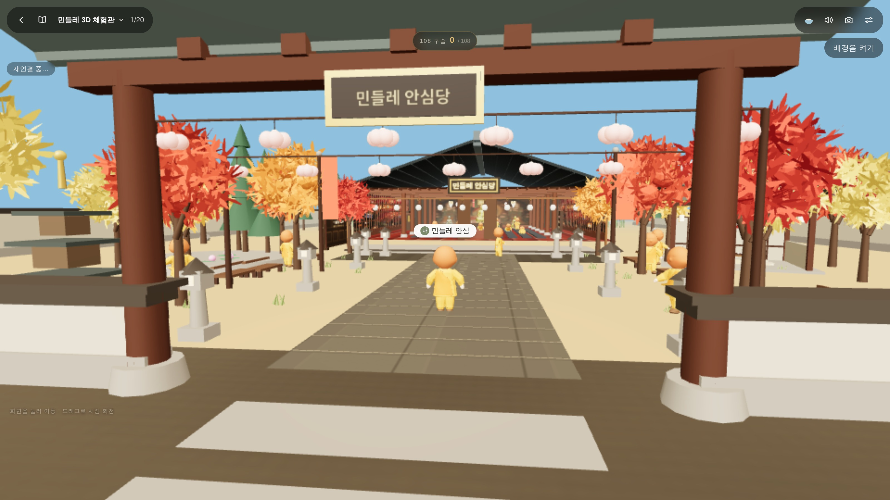 |
| 바깥 마당과 담장 | 돌길과 단풍 |
| 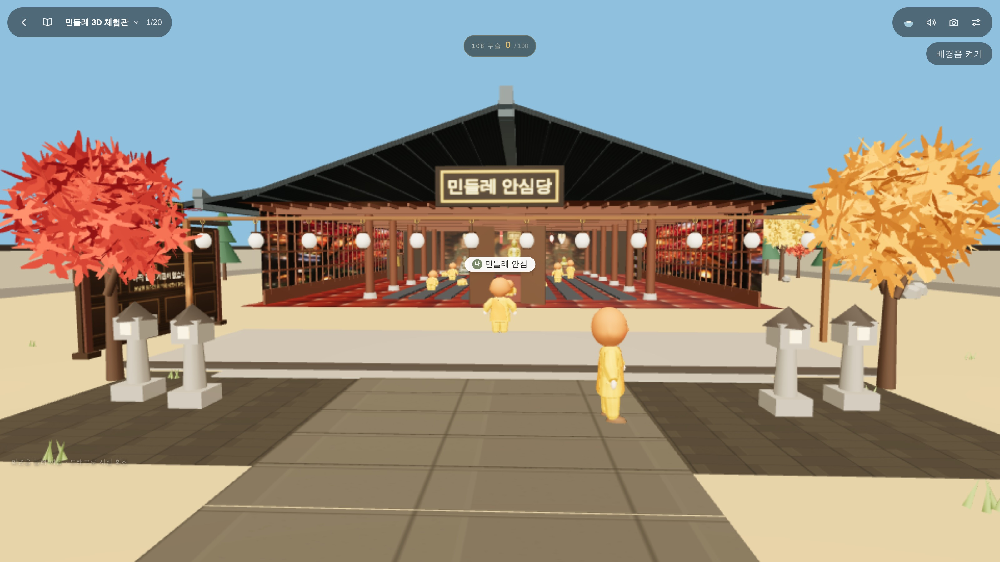 | 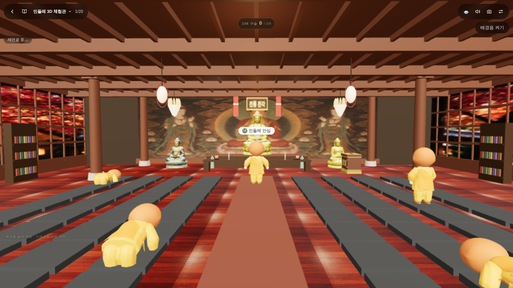 |
| 전각 정면 — 현판과 마당 | 전각 안쪽 |
| 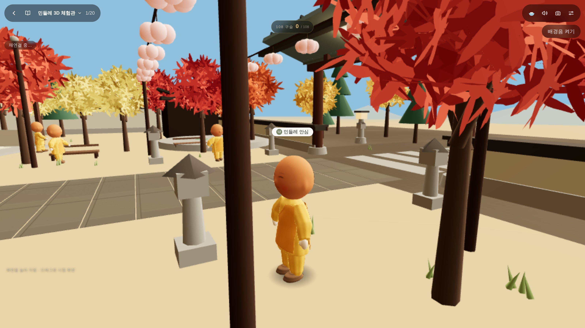 | 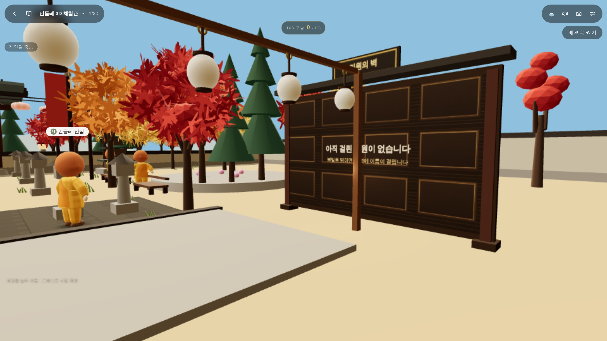 |
| 마당 석조물 | 메시지 벽 — 7일 동안 이름이 걸리는 벽 |
| 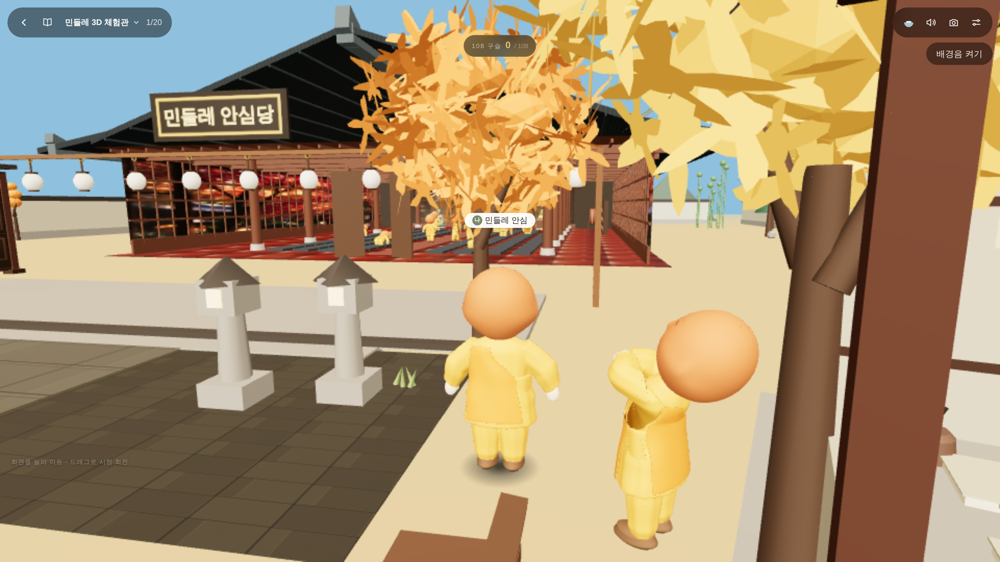 | 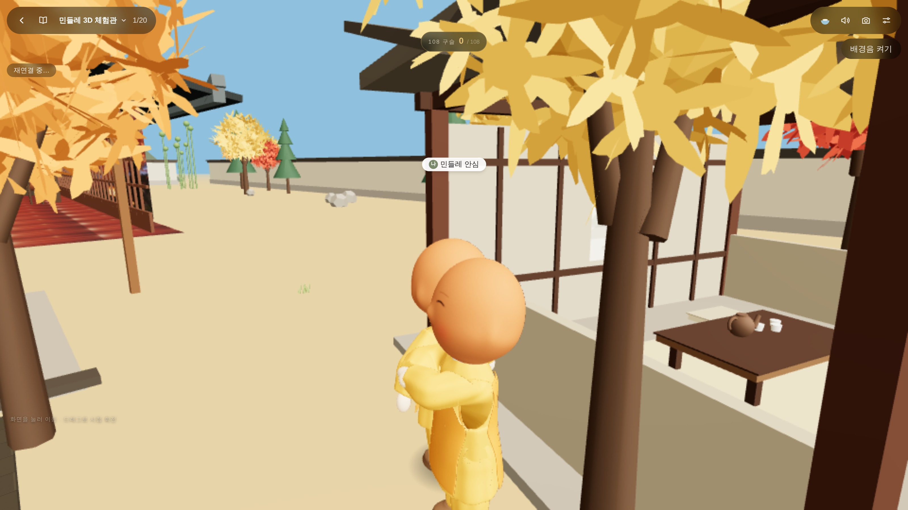 |
| 평상 6석 — 앉아서 쉬어가기 | 차실 — 방석 4석 |
| 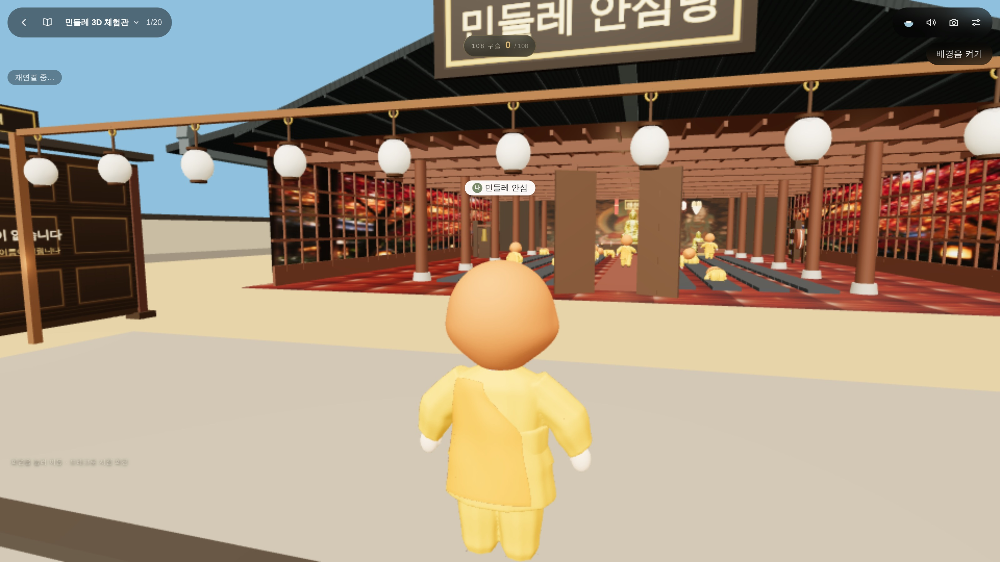 | 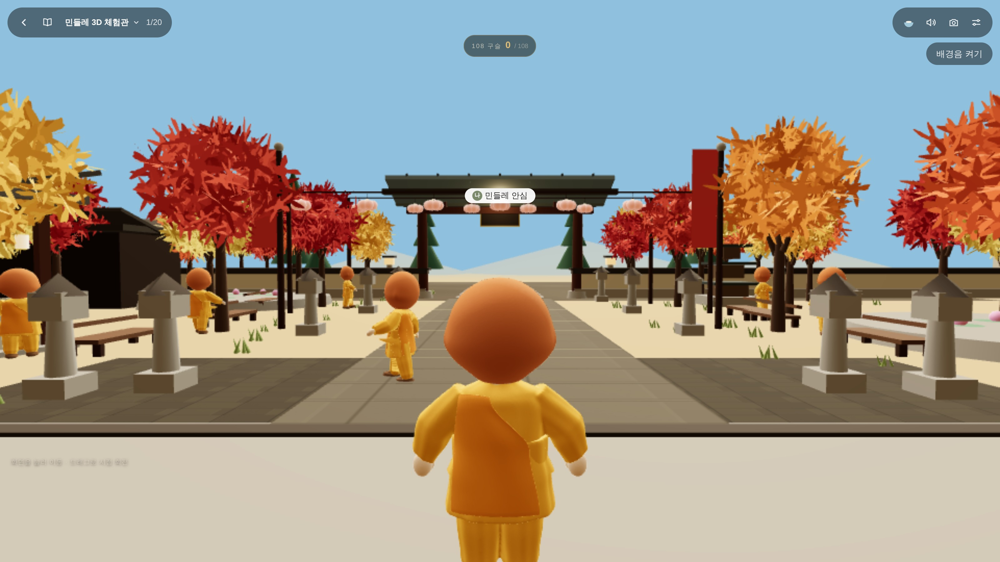 |
| 캐릭터 근경 — 눈 감고 미소 짓는 얼굴 | 라이트 — 산문 등불과 마당 |

## 1. 구현된 기능

| 항목 | 내용 |
|---|---|
| 입구 화면 | 먹빛 산등성이, 108 구슬 고리, 제목, `4D 체험 시작` 버튼, 소리 켜기 |
| 4D 공간 | 붉은 원목 바닥, 벽화, 격자창과 창밖 단풍, 기둥 8본과 주초, 천장 서까래, 향탁, 향로, 촛대, 화병, 방석 16석, 입체 모형과 온기 조명 |
| 입체 모형 | 중앙 좌상, 좌우 입상, 정면 벽화. 모델이 없으면 절차적 금색 좌상으로 대체되어 빈 자리가 드러나지 않음 |
| 캐릭터(플레이어) | 17개 뼈대 기반. 손 모으기·예 갖추기·구슬·나무북·행보·좌위(바닥·차실·평상) 자세, 자세 전환은 0.22초 보간으로 프레임레이트와 무관 |
| 108 구슬 | 원반을 돌리거나 `한 알 굴리기` 로 한 알씩 세기, 108알마다 한 바퀴, 남은 알과 완료 바퀴 표시, 초기화 가능 |
| 동작 | `손 모으기`(1.5초 자동 종료), `예 갖추기`(일어서기까지 유지), `나무북`(0.7초), `구슬`(원반 열기), `향 올리기`(4단계 연결 동작), `라이트 걸기` |
| 원내 시설 | 다층 조형물 `돌기`, `종 치기`(3배음 종소리와 종체 흔들림), 향 연기, 라이트, 차실(방석 4석), 평상 6석, 메시지 벽 |
| 메시지 벽 | 표시 이름이 목패로 걸리고 15초마다 자동으로 면이 넘어감. 7일이 지난 이름은 자동으로 내려가고, 내 이름은 금색 테두리로 표시 |
| 체험권 | 라이트·꽃·물 신청 창. 이름과 표시 문구를 남기면 공간에 기록됨 |
| 다인 모드 | 같은 방 참여자의 위치·방향·동작 동기화. 서로 통과하지 않고 1.5m 이내로 다가서면 자동으로 비켜서며, 마주치면 서로 숙여 인사하고 다시 비켜남 |

## 2. 기술 스택

- React 18 + TypeScript
- Vite 5
- Three.js 0.160 + @react-three/fiber 5 + @react-three/drei
- Tailwind CSS 3
- WebSocket (다인 모드, 선택)

## 3. 디렉터리 구조

```
src/
├── api/          # 서버 API 계층 (라이트 목록, 결제 진입)
├── assets/       # 모델·텍스처·음원 (public/assets 로 복사)
├── player/       # 캐릭터 렌더링과 포즈 테이블
├── scene/        # 전각, 마당, 차실, 메시지 벽, 조형물
├── ui/           # 입구, HUD, 동작 바, 설정, 체험권 창, 약관 고지
├── App.tsx       # 장면 / 입구 / HUD 조립
├── audio.ts      # 3채널 오디오
├── mala.ts       # 108 구슬 계산
└── store.ts      # HUD / 구슬 / 원격 참여자 상태
```

## 4. 로컬 실행

```bash
npm install
npm run dev        # 개발 모드, http://localhost:5173
npm run build      # 배포용 dist/
npm run preview    # 빌드 결과 미리보기
```

정적 배포만 필요하면 `VITE_WS_URL=off npm run build` 로 다인 모드를 끕니다.

### 다인 모드

```bash
npm run server                                  # WebSocket 서버 (기본 8080)
VITE_WS_URL=ws://localhost:8080 npm run dev     # 프런트 연결
```

## 5. 조작

| 동작 | 방법 |
|---|---|
| 이동 | 방향키 / WASD, 모바일은 화면 왼쪽 조이스틱 |
| 시점 | 마우스 드래그, 휠 줌 |
| 손 모으기 | `손 모으기` 클릭 |
| 예 갖추기 / 일어서기 | `예 갖추기` 토글 |
| 나무북 | `나무북` 클릭 |
| 108 구슬 | `구슬` 로 원반 열기 |
| 앉기 | 평상·차실·방석 가까이에서 앉기 버튼 |

이동하면 진행 중인 동작이 끊깁니다. 손 모으기와 나무북은 한 번 동작 후 대기 자세로 돌아갑니다.

## 6. 수정 안내

- **공간 배치**: `src/scene/ExperienceScene.tsx`
- **입체 모형**: `public/assets/models/` 의 모델 파일. 없으면 절차적 모형으로 대체
- **구슬 계산**: `src/mala.ts`
- **문구·가격**: `src/api/lamps.ts`

## 7. 자료 출처와 라이선스

| 자료 | 출처 | 라이선스 | 변경 |
|---|---|---|---|
| 음원 | 김용배, 공유마당(한국문화정보원) | CC BY 4.0 | 볼륨 조절·재생 방식 변경 |
| 입체 모형 | 국립중앙박물관 | 공공누리 제1유형 | 크기·배치 조정 |

상업적 이용이 허용된 라이선스이며, 전문은 `public/terms.html` 제8조에 있습니다. 앱 내 설정 화면에도 저작자 표시가 들어 있습니다. **이 표시는 라이선스 조건이므로 삭제하면 안 됩니다.**

## 8. 배포

`npm run build` 결과(`dist/`)를 웹 서버 디렉터리에 올리면 끝입니다. 다인 모드까지 쓰려면 `server/ws-server.mjs` 를 같은 서버에서 띄우고, `VITE_WS_URL=wss://<도메인>/ws` 로 다시 빌드합니다.

- 한 전각 정원은 **100명** 입니다. 정원이 차면 다음 전각이 자동으로 열리고(2호, 3호 …), 사람이 빠져 빈 전각은 자동으로 닫힙니다. 별도 설정 없이 동작합니다.
- 서버 환경변수: `PORT`(기본 8090), `CAPACITY`(전각당 정원, 기본 100), `MAX_HALLS`(자동으로 열 수 있는 전각 수, 기본 100), `ALLOW_ORIGIN`(허용 도메인 목록).
- 위치 정보는 200ms 마다 한 번씩 모아서 보내므로, 한 전각에 100명이 있어도 회선 부담이 크지 않습니다.
- 운영 상태는 `https://3d.mindulle.kr/monitor.html` 에서 확인합니다. 같은 서버의 `/health`(=`/ws-health`) 를 읽어 접속 인원·전각 수·메모리를 보여 줍니다.

체험권 결제는 `care/donate.php` 로 이동하며, 결제와 개인정보 처리는 해당 서버에서 이루어집니다.

## 9. 알려진 경계

- 표시 이름은 7일 후 자동으로 내려가며, 목록 API 에서는 첫 글자 외 가려서 내려갑니다.
- 다인 모드는 서버가 없으면 자동으로 단일 모드로 동작합니다.
- 모바일에서는 그림자 품질이 낮아지는 대신 프레임을 유지합니다.
