# 민들레 4D 体验馆 · Mindulle Digital Experience

以传统建筑为题材的 4D 数字体验空间。打开浏览器即可进入，用 Three.js 实时渲染。场景中的角色基于项目自带的 glTF 模型，由 17 根骨骼驱动，做出合手、行礼、数珠、敲木鼓等动作。声音分环境音、背景音、效果音三路独立调音量。

本仓库不是截图或设计稿，而是可以立即运行、修改、部署的 React + Vite 项目。`npm install` 后即可运行，`npm run build` 生成静态托管用的 `dist/`。

> 本服务由个人事业者 민들레 안심케어（营业执照号 118-08-71419）运营，属商业性数字内容，不是宗教法人的官方渠道；付费是购买数字内容使用券，不是捐赠。

## 画面

| | |
|---|---|
|  | 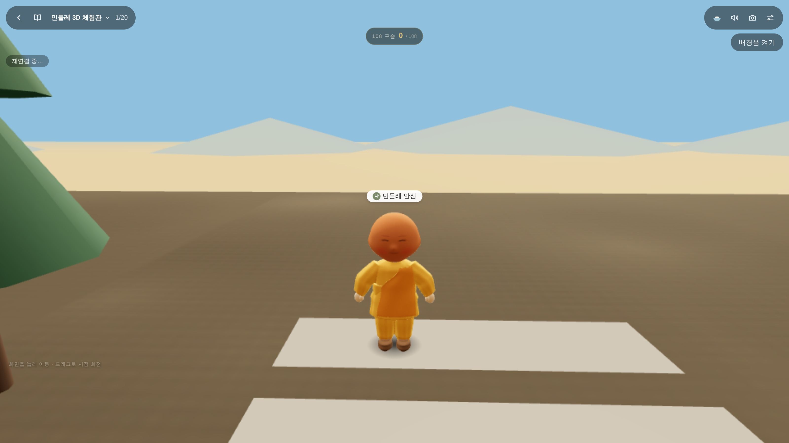 |
| 封面 — 标题与事业者信息 | 入口页 — 108 珠环与 `4D 体验开始` 按钮 |
| 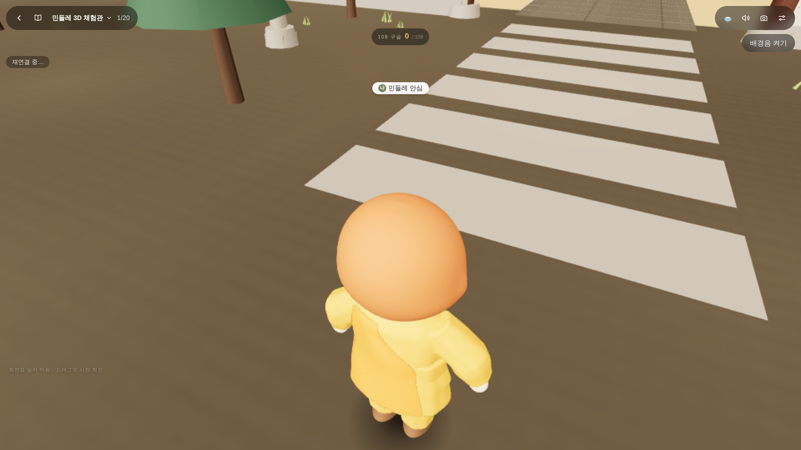 | 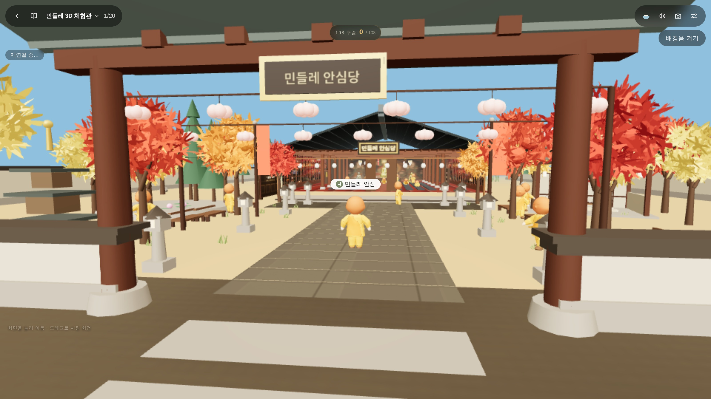 |
| 外部庭院与围墙 | 石径与红叶 |
| 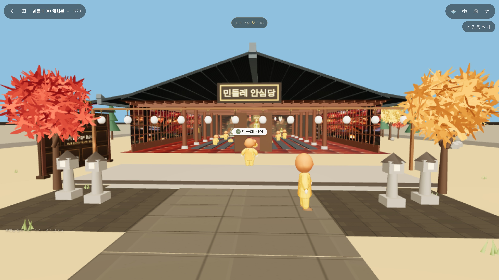 | 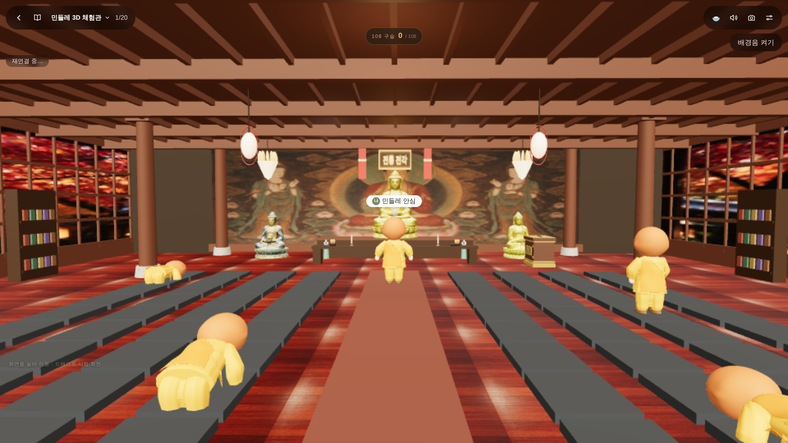 |
| 殿正面 — 匾额与庭院 | 殿内侧景 |
| 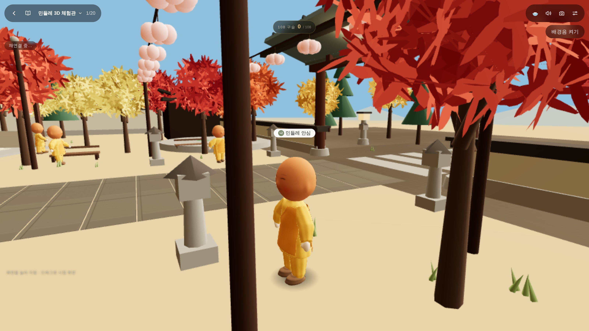 | 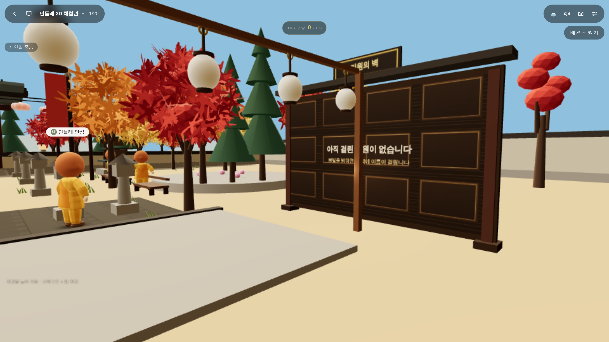 |
| 庭院石构物 | 留言墙 — 名字挂 7 天 |
| 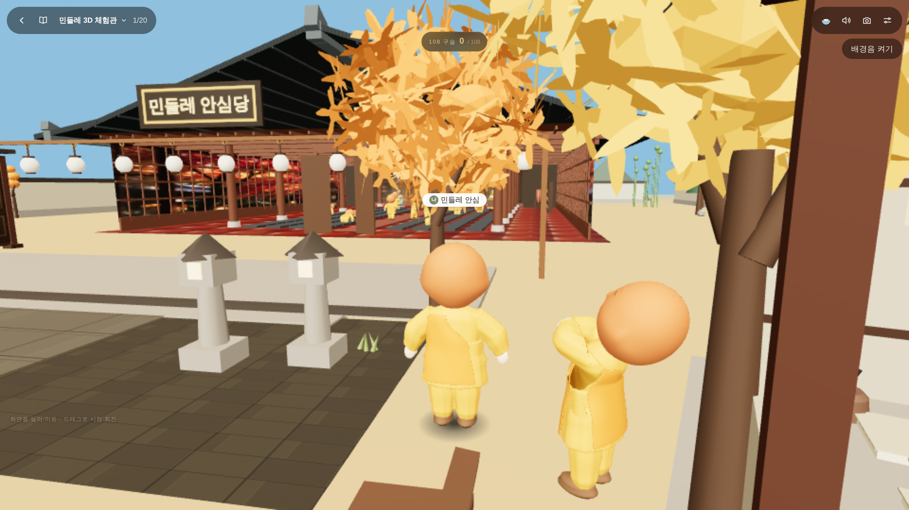 | 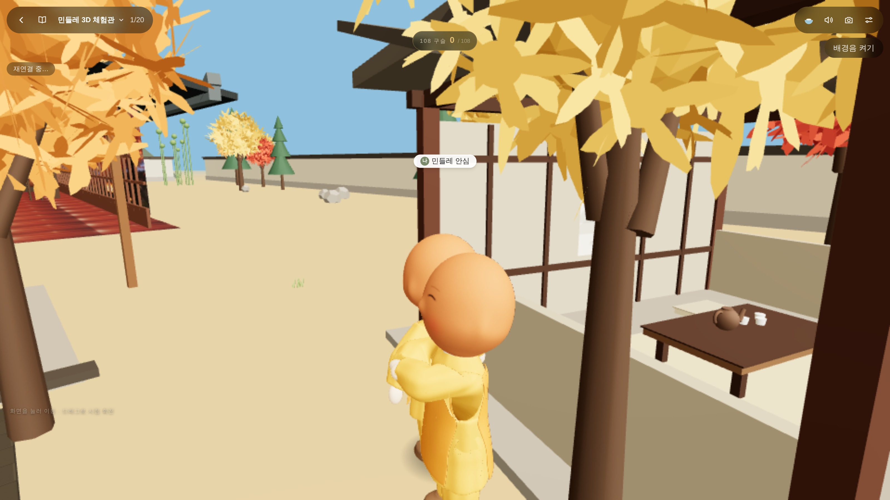 |
| 长凳 6 席 — 可坐下歇息 | 茶室 — 坐垫 4 席 |
| 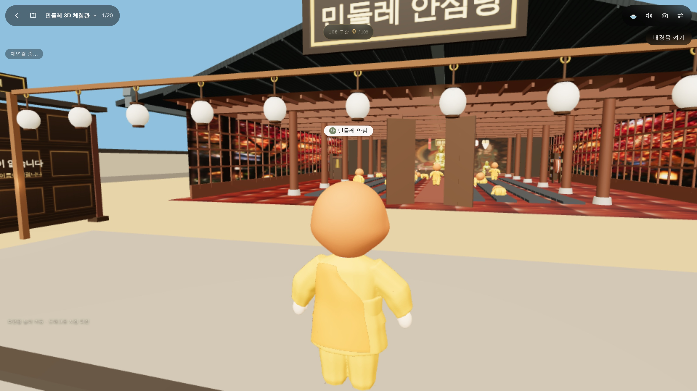 | 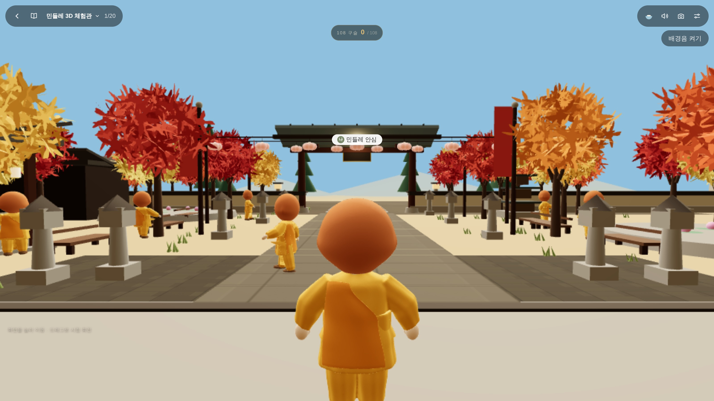 |
| 角色近景 — 闭眼微笑的同一张脸 | 灯 — 山门灯笼与庭院 |

## 1. 已实现功能

| 项目 | 内容 |
|---|---|
| 入口页 | 墨色山影、108 珠环、标题、`4D 体验开始` 按钮、声音开关 |
| 4D 空间 | 红木地面、壁画、格窗与窗外红叶、8 根立柱与柱础、天花椽条、香案、香炉、烛台、花瓶、坐垫 16 席、立体模型与暖光 |
| 立体模型 | 中央坐像、左右立像、正面壁画。模型缺失时以程序化金色坐像替代，不会露出空缺 |
| 角色（玩家） | 基于 17 根骨骼。合手、行礼、数珠、敲木鼓、行走、坐姿（地面·茶室·长凳），姿态切换 0.22 秒插值，与帧率无关 |
| 108 珠 | 转动圆盘或 `滚一颗` 逐颗计数，每 108 颗计一圈，显示剩余与已完成圈数，可重置 |
| 动作 | `合手`（1.5 秒自动结束）、`行礼`（起身为止保持）、`敲木鼓`（0.7 秒）、`数珠`（打开圆盘）、`上香`（4 段连贯动作）、`挂灯` |
| 院内设施 | 多层石构物 `绕行`、`撞钟`（3 声钟响与钟体摆动）、香雾、灯光、茶室（4 席）、长凳 6 席、留言墙 |
| 留言墙 | 显示名以木牌挂起，每 15 秒自动翻面。满 7 天的名字自动下架，自己的名字以金边标示 |
| 体验券 | 灯·花·水 申请窗。填写显示名与展示文字后记录到空间 |
| 多人模式 | 同房间参与者的位置、朝向、动作同步。互不穿透，1.5 米内靠近会自动避让，正面相遇时彼此鞠躬再让开 |

## 2. 技术栈

- React 18 + TypeScript
- Vite 5
- Three.js 0.160 + @react-three/fiber 5 + @react-three/drei
- Tailwind CSS 3
- WebSocket（多人模式，可选）

## 3. 目录结构

```
src/
├── api/          # 服务端 API 层（灯列表、支付入口）
├── assets/       # 模型·贴图·音频（复制到 public/assets）
├── player/       # 角色渲染与姿态表
├── scene/        # 殿堂、庭院、茶室、留言墙、石构物
├── ui/           # 入口、HUD、动作栏、设置、体验券窗、条款提示
├── App.tsx       # 场景 / 入口 / HUD 组装
├── audio.ts      # 三路音频
├── mala.ts       # 108 珠计算
└── store.ts      # HUD / 珠数 / 远端参与者状态
```

## 4. 本地运行

```bash
npm install
npm run dev        # 开发模式，http://localhost:5173
npm run build      # 生成 dist/
npm run preview    # 预览构建结果
```

只需静态部署时，用 `VITE_WS_URL=off npm run build` 关掉多人模式。

### 多人模式

```bash
npm run server                                  # WebSocket 服务（默认 8080）
VITE_WS_URL=ws://localhost:8080 npm run dev     # 前端连接
```

## 5. 操作

| 动作 | 方法 |
|---|---|
| 移动 | 方向键 / WASD，手机为屏幕左侧摇杆 |
| 视角 | 鼠标拖拽、滚轮缩放 |
| 合手 | 点 `合手` |
| 行礼 / 起身 | `行礼` 切换 |
| 敲木鼓 | 点 `敲木鼓` |
| 108 珠 | 点 `数珠` 打开圆盘 |
| 坐下 | 靠近长凳·茶室·坐垫时点坐下按钮 |

移动会中断正在进行中的动作。合手与敲木鼓做一次后回到待机姿态。

## 6. 修改指引

- **空间布置**：`src/scene/ExperienceScene.tsx`
- **立体模型**：`public/assets/models/` 下的模型文件，缺失时以程序化模型替代
- **珠数计算**：`src/mala.ts`
- **文案与价格**：`src/api/lamps.ts`

## 7. 素材出处与许可

| 素材 | 出处 | 许可 | 变更 |
|---|---|---|---|
| 音频 | 김용배, 共享广场（韩国文化信息院） | CC BY 4.0 | 调整音量与播放方式 |
| 立体模型 | 国立中央博物馆 | 공공누리 第1类型 | 调整尺寸与摆放 |

两项许可均允许商业使用，完整条款见 `public/terms.html` 第 8 条，应用内设置页也保留了作者署名。**该署名是许可条件，不可删除。**

## 8. 部署

把 `npm run build` 产出的 `dist/` 上传到网站目录即可。要用多人模式，则在同一台服务器上启动 `server/ws-server.mjs`，并用 `VITE_WS_URL=wss://<域名>/ws` 重新构建。

- 单殿容量 **100 人**。满员会自动开下一殿（2 号、3 号…），人走空后该殿自动关闭，无需额外配置。
- 服务端环境变量：`PORT`（默认 8090）、`CAPACITY`（单殿容量，默认 100）、`MAX_HALLS`（可自动开启的殿数，默认 100）、`ALLOW_ORIGIN`（允许的域名）。
- 位置每 200ms 合并上报一次，一殿 100 人同时走动也不会把带宽打满。

体验券支付会跳转到 `care/donate.php`，支付与个人信息处理都在该服务器完成。

## 9. 已知边界

- 显示名 7 天后自动下架，列表接口只返回首字其余打码。
- 多人模式在没有服务端时自动退化为单人模式。
- 移动端会降低阴影质量以保持帧率。
